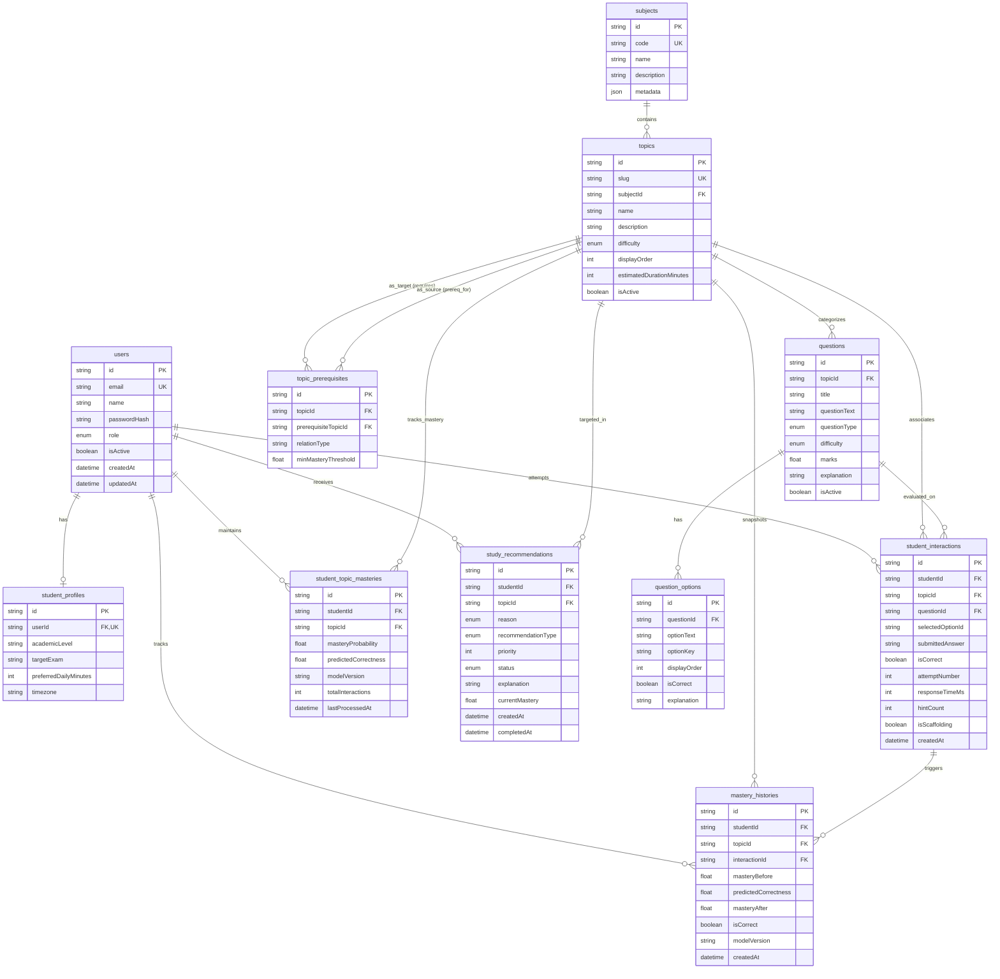
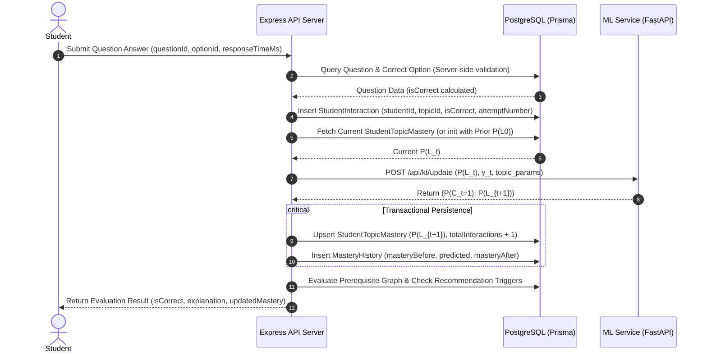

# Relational Database Architecture & PostgreSQL Schema Design

**Project:** Knowledge-Tracing-Based Adaptive Topic Recommendation for Personalized Study Planning  
**Academic Level:** 3rd Year, B.Tech Computer Science and Engineering  
**Project Owner:** Neeraj Mishra  
**Workspace:** `N:\adaptive-study-planner`  
**ORM:** Prisma ORM 6.x (`@prisma/client`)  
**Target RDBMS:** PostgreSQL 15+  
**Schema File:** `backend/prisma/schema.prisma`  

---

## 1. Executive Summary & Design Rationale

The database architecture for the Adaptive Study Planner provides the persistent foundation for:
1. Student identity and learning profile management.
2. Structured subject and topic hierarchy (Data Structures & Algorithms).
3. Self-referencing topic prerequisite dependency graphs (**Directed Acyclic Graphs / DAG**).
4. Academic question items, multi-choice options, and assessment content.
5. High-throughput, sequential student interaction logging.
6. Real-time Bayesian Knowledge Tracing (**BKT**) latent mastery state tracking and audit history snapshots.
7. Explainable adaptive study recommendations.

### Design Principles:
- **Strict 3NF Normalization:** Avoid duplicate storage of derived mastery scores or redundant user attributes.
- **Surrogate UUID Keys:** Standardized UUIDv4 primary keys across all entities ensure distributed uniqueness, portable replication, and seamless synchronization.
- **Chronological Interaction Integrity:** Student attempts are modeled as append-only time-series records (`StudentInteraction`). Historical attempts are never overwritten, preserving full interaction sequences required for sequential probabilistic knowledge tracing.
- **Relational Integrity & Referential Actions:** Foreign keys with explicit `ON DELETE CASCADE` or `ON DELETE SET NULL` constraints preserve referential consistency across deletions.
- **Zero JSON-blob state anti-patterns:** Core domain logic, mastery states, prerequisites, and questions are modeled in first-class relational tables, with JSON fields reserved strictly for unstructured client telemetry or curriculum metadata.

---

## 2. Entity-Relationship (ER) Architecture

---

## 3. Core Database Entities & Field Specifications

### 3.1 Identity & User Profiles (`users`, `student_profiles`)
- **`User` Entity:** Manages core credentials, identity, access control roles (`STUDENT`, `INSTRUCTOR`, `ADMIN`), and account state. The `passwordHash` field is marked nullable to support seed scripts and future authentication adapters.
- **`StudentProfile` Separation Decision:** Decoupling `StudentProfile` from `User` into a distinct 1-to-1 table is an essential architectural decision:
  1. *Role Specialization:* Instructors or administrators do not require learning metrics, target placement exams, or daily study minute targets.
  2. *Schema Evolution:* Academic preferences (e.g. semester, target company/GATE syllabus) can evolve without altering core authentication and user tables.
  3. *Security:* Operational learning telemetry queries never load sensitive authentication credentials.

### 3.2 Curriculum Hierarchy & Topics (`subjects`, `topics`)
- **`Subject`:** High-level academic subject. Initial subject: Data Structures & Algorithms (`code = "dsa"`).
- **`Topic`:** Granular conceptual component. Stores slug (e.g. `dsa_binary_search_trees`), display order, human-readable learning objectives, difficulty tier, and expected completion duration.
- *Stable Identifiers:* Topics utilize stable text slugs (`slug`) in addition to UUIDs, enabling portable configuration and seamless mapping to ML service knowledge component identifiers.

### 3.3 Topic Prerequisite Dependency Graph (`topic_prerequisites`)
- Models the self-referencing directed edges between topics in the curriculum.
- **Fields:**
  - `topicId`: The target/dependent topic requiring prerequisite mastery.
  - `prerequisiteTopicId`: The source prerequisite topic.
  - `minMasteryThreshold`: Minimum BKT probability ($P(L) \ge \tau$, default `0.75`) required before the target topic becomes unlocked or recommended for advanced study.
- **Constraints:**
  - Composite unique index `@@unique([topicId, prerequisiteTopicId])` prevents duplicate directed edges.
  - Individual foreign key indexes on `topicId` and `prerequisiteTopicId` accelerate topological traversal.

#### Prerequisite Directed Acyclic Graph (DAG) Integrity & Cycle Prevention:
Relational foreign keys enforce edge existence but cannot natively guarantee that a graph remains acyclic (i.e. no cycles such as $A \to B \to C \to A$). Cycle prevention is guaranteed via **two-tier enforcement**:
1. **Database Level:** Unique constraint prevents self-loops (`topicId = prerequisiteTopicId` rejected by validation check).
2. **Application Level (Prerequisite Validator):** When creating or updating prerequisite relationships, the backend runs a **Depth-First Search (DFS) Cycle Detection algorithm** using three-color marking (White = unvisited, Gray = visiting, Black = visited):
   $$\text{HasCycle}(G) = \exists v \in V \text{ such that } v \text{ has an edge to a Gray node}$$
   Any operation attempting to insert an edge that would create a directed cycle is rejected before transaction commit with a `400 Bad Request` (`PrerequisiteCycleError`).

### 3.4 Assessment & Question Bank (`questions`, `question_options`)
- **`Question`:** Stores question text, difficulty, cognitive type (`MULTIPLE_CHOICE`, `MULTIPLE_SELECT`, `NUMERICAL`, `CODE_TRACE`, `TRUE_FALSE`), marks, and answer explanations.
- **`QuestionOption`:** Stores choices for objective items.
- **Security & Data Hiding:** The field `isCorrect` and detailed explanation in `QuestionOption` are strictly excluded from student-facing exam/practice payloads. They are only queried server-side during response evaluation.

### 3.5 Student Interaction Logging (`student_interactions`)
- Stores individual student attempts at questions.
- **Fields:** `studentId`, `topicId`, `questionId`, `selectedOptionId`, `submittedAnswer`, `isCorrect` ($y_t \in \{0, 1\}$), `attemptNumber`, `responseTimeMs`, `hintCount`, `isScaffolding`.
- **Append-Only Time-Series:** Attempt records are never overwritten. When a student re-attempts a problem, a new record is inserted with `attemptNumber = N+1`.
- **Indexing:** High-performance composite index `@@index([studentId, topicId, createdAt])` allows instantaneous chronological retrieval of a student's practice sequence for a given topic.

### 3.6 Bayesian Knowledge Tracing Persistence (`student_topic_masteries`, `mastery_histories`)
The architecture separates **current belief state** from **historical trajectory audit logs**:
1. **`StudentTopicMastery` (Current State):**
   - Enforces the unique invariant `@@unique([studentId, topicId])` — exactly one current belief record per student-topic pair.
   - Stores `masteryProbability` ($P(L_t) \in [0, 1]$: hidden latent cognitive belief).
   - Stores `predictedCorrectness` ($P(C_t=1) \in [0, 1]$: emission probability forecasted before observation).
   - Records `totalInteractions` and `lastProcessedInteractionId` for idempotency.
2. **`MasteryHistory` (Audit Snapshots):**
   - Records exact belief transitions: `masteryBefore` $\to$ `masteryAfter`, alongside `predictedCorrectness` and the triggering `interactionId`.
   - Enables temporal learning curve visualization on student dashboards and scientific auditing of model calibration over time.

### 3.7 Explainable Study Recommendations (`study_recommendations`)
- Stores system-generated recommendation items.
- **Explainable Reasons:** `LOW_MASTERY`, `PREREQUISITE_DEFICIT`, `SPACED_REVISION_DUE`, `WEAK_RECENT_ACCURACY`, `FOUNDATIONAL_NEXT`.
- **Actionable Types:** `PRACTICE_QUESTIONS`, `CONCEPT_REVIEW`, `REMEDIAL_PREREQUISITE`, `CHALLENGE_ADVANCED`.
- **Lifecycle Management:** Status tracks progression: `PENDING` $\to$ `ACCEPTED` $\to$ `IN_PROGRESS` $\to$ `COMPLETED` or `DISMISSED`.

---

## 4. Student Interaction & Knowledge Tracing Data Flow

---

## 5. Research Benchmark Data vs Application Data Separation

To maintain strict scientific integrity, **the ASSISTments research dataset is strictly segregated from live application operations**:

| Operational Dimension | Research Benchmark Data | Live Application Data |
|---|---|---|
| **Storage Location** | File system CSV / JSON artifacts (`ml-service/data/`) | PostgreSQL Relational Database (`backend/prisma/`) |
| **Data Scope** | 324,449 historical interactions from Worcester Polytechnic | Real student attempts on Data Structures & Algorithms |
| **Student Identifiers** | Anonymized integer research IDs (`user_id = 70872`) | UUIDv4 application user accounts (`users.id`) |
| **Skill Mappings** | 104 ASSISTments math skill codes (`skill_id = 50`) | 12 DSA curriculum topic slugs (`dsa_arrays`, etc.) |
| **Model Usage** | Offline training, parameter bounds estimation, benchmark AUC | Online inference, real-time belief updates, study planning |
| **Data Pollution Prevention** | Research datasets are read-only; scripts never insert into Postgres | Live student interactions never alter benchmark test sets |

---

## 6. Indexing Strategy & Performance Considerations

| Table | Index Columns | Index Type | Query Objective & Rationale |
|---|---|---|---|
| `users` | `[email]` | B-tree (Unique) | $O(1)$ credential lookup during authentication. |
| `student_profiles` | `[userId]` | B-tree (Unique) | Instantaneous 1-to-1 profile retrieval. |
| `topics` | `[slug]` | B-tree (Unique) | Fast identifier lookup when routing API topic requests. |
| `topics` | `[subjectId, displayOrder]` | B-tree (Composite) | Ordered curriculum listing for subject syllabus views. |
| `topic_prerequisites` | `[topicId, prerequisiteTopicId]` | B-tree (Unique) | Prevents duplicate edges; enforces edge uniqueness. |
| `topic_prerequisites` | `[prerequisiteTopicId]` | B-tree | Inverted lookup: "Which topics depend on this prerequisite?" |
| `questions` | `[topicId, difficulty]` | B-tree (Composite) | Adaptive item selection: querying questions by topic and difficulty. |
| `student_interactions`| `[studentId, topicId, createdAt]`| B-tree (Composite) | Primary time-series index for sequential BKT inference and student history. |
| `student_topic_masteries`| `[studentId, topicId]` | B-tree (Unique) | Guarantees single active mastery state; fast $O(1)$ state retrieval. |
| `mastery_histories` | `[studentId, topicId, createdAt]`| B-tree (Composite) | Learning curve plotting and temporal progress analytics. |
| `study_recommendations`| `[studentId, status]` | B-tree (Composite) | Fast retrieval of active/pending study tasks on student dashboard. |

---
*Certified for Phase 6 Database Architecture and Prisma ORM Implementation.*
