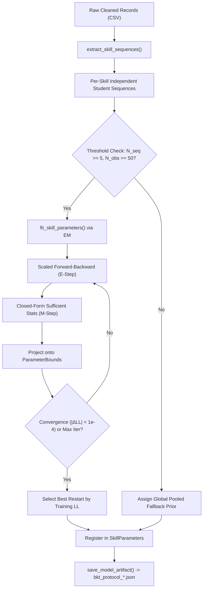

# BKT Software Architecture and Modular Engineering Design

**Project:** Knowledge-Tracing-Based Adaptive Topic Recommendation for Personalized Study Planning  
**Phase:** 5 / 5.1 — Bayesian Knowledge Tracing Implementation, Evaluation & Audit  
**Directory Structure:** `ml-service/app/knowledge_tracing/bkt/` and `ml-service/app/evaluation/`  

---

## 1. Modular Package Architecture

The Knowledge Tracing and Evaluation engine is organized into clean, single-responsibility modules:

```text
ml-service/
├── app/
│   ├── knowledge_tracing/
│   │   ├── __init__.py
│   │   └── bkt/
│   │       ├── __init__.py
│   │       ├── exceptions.py       # Custom exception hierarchy (BKTError, InvalidParameterError, etc.)
│   │       ├── parameters.py       # BKTParameters, ParameterBounds, SkillParameters registry
│   │       ├── model.py            # Pure mathematical functions (prediction, Bayes posterior, transition)
│   │       ├── inference.py        # Sequential online sequence processing (predict before update)
│   │       ├── em.py               # Baum-Welch (EM) estimation with scaled forward-backward
│   │       └── serialization.py   # Portable JSON model artifact save/load
│   └── evaluation/
│       ├── __init__.py
│       ├── classification_metrics.py # Accuracy, Precision, Recall, F1, ROC-AUC, Confusion Matrix
│       ├── probability_metrics.py    # Log Loss, Brier Score, Reliability Bins, Expected Calibration Error (ECE)
│       ├── baselines.py              # Laplace-Smoothed & Hard Majority Class, Global Rate, Per-Skill Rate
│       └── evaluation_runner.py      # End-to-end runner for Protocol A and Protocol B
├── models/
│   └── artifacts/                    # Serialized JSON model checkpoints (.gitkeep preserved)
│       ├── bkt_protocol_a.json
│       └── bkt_protocol_b.json
└── data/
    └── reports/
        └── bkt/                      # Detailed evaluation and cohort JSON logs
            ├── protocol_a_results.json
            ├── protocol_b_results.json
            └── protocol_b_cohort_metadata.json
```

---

## 2. Component Responsibility Matrix

| Module | Core Responsibility | Key Classes / Functions | Dependencies |
|---|---|---|---|
| `exceptions.py` | Error modeling & boundary failures | `BKTError`, `InvalidParameterError`, `NumericalInstabilityError` | Python `stdlib` |
| `parameters.py` | Parameter validation, boundaries & store | `BKTParameters`, `ParameterBounds`, `SkillParameters`, `clamp_parameters_to_bounds` | `exceptions.py` |
| `model.py` | Pure elementary mathematical formulas | `predict_correct_probability`, `posterior_learned_given_correct`, `apply_learning_transition`, `update_mastery` | `exceptions.py` |
| `inference.py` | Sequential chronological inference | `predict_student_skill_sequence`, `predict_student_all_skills`, `initialize_student_from_history` | `model.py`, `parameters.py` |
| `em.py` | Maximum Likelihood estimation via EM | `scaled_forward`, `scaled_backward`, `e_step_single_sequence`, `m_step`, `fit_skill_parameters`, `fit_all_skills` | `numpy`, `parameters.py` |
| `serialization.py` | JSON artifact persistence | `save_model_artifact`, `load_model_artifact`, `save_evaluation_report` | `parameters.py`, `json` |
| `classification_metrics.py` | Thresholded classification & ROC-AUC | `accuracy`, `precision`, `recall`, `f1_score`, `confusion_matrix`, `roc_auc` (pure NumPy trapezoid) | `numpy` |
| `probability_metrics.py` | Calibration & continuous likelihood | `log_loss`, `brier_score`, `compute_calibration_bins`, `expected_calibration_error`, `compute_all_metrics` | `classification_metrics.py` |
| `baselines.py` | Non-KT benchmark predictors | `MajorityClassBaseline` (Laplace-smoothed & Hard), `GlobalCorrectnessRateBaseline`, `PerSkillCorrectnessRateBaseline` | `collections` |
| `evaluation_runner.py` | Experiment orchestrator | `run_protocol_a`, `run_protocol_b`, `group_by_student`, `extract_skill_sequences` | All above modules |

---

## 3. Data Flow Workflows

### 3.1 Training Workflow (Parameter Estimation)



### 3.2 Online Inference Workflow (Sequential Prediction)


---

## 4. Leakage-Safe Evaluation Design

### Protocol A: Unseen-Student Generalization
- **Training Cohort:** 2,573 disjoint students (227,011 interactions).
- **Validation Cohort:** 551 disjoint students (45,297 interactions).
- **Test Cohort:** 552 disjoint students (52,141 interactions).
- Global parameters $\theta_k$ are fitted strictly on Training students.
- Evaluation on Test students simulates incoming new users: $P(L_0)$ initializes each skill, and states update trial-by-trial sequentially.

### Protocol B: Known-Student Future Prediction
- **Parameter-Training Cohort:** 2,573 disjoint students used strictly to estimate $\theta_k$.
- **Evaluation Cohort:** 1,103 disjoint students.
- For each evaluation student:
  - First 80% interactions (`history`) initialize that student's mastery profile.
  - Final 20% interactions (`future_test`) are evaluated sequentially without ever exposing future trials to parameter estimation.
